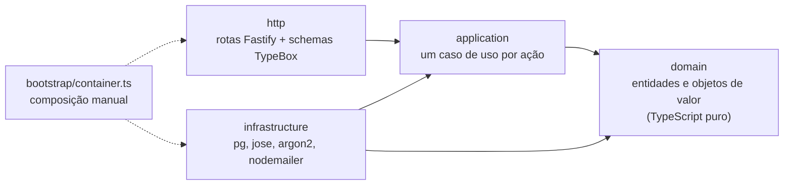

# Goomer Menu API (TypeScript)

API para um restaurante cadastrar produtos e promoções com dia e hora marcados, e publicar o cardápio do momento.
Se é sexta às 18h30 no fuso do restaurante, o cardápio já sai com o chopp em promoção. Às 20h, a promoção some
sozinha.

É a versão em TypeScript do desafio técnico da Goomer, a trilha 1 do plano: Node 22, Fastify, SQL escrito à mão e
testes em quatro níveis. O plano completo, com as mesmas regras em PHP e Java, está em
[`docs/visao-geral.md`](docs/visao-geral.md).

**Destaques**

- **Cardápio em uma consulta só:** um `LEFT JOIN LATERAL` monta o cardápio, já no fuso de cada restaurante.
- **Regras garantidas duas vezes:** o domínio valida, e o Postgres garante de novo com `CHECK` e `EXCLUDE USING gist`.
  Nem um `INSERT` feito direto no banco consegue criar duas promoções sobrepostas.
- **Domínio em TypeScript puro:** o dependency-cruiser falha se ele importar o Fastify, o `pg`, um módulo do Node ou
  até a camada de aplicação.
- **Log de auditoria em toda escrita:** quem fez, o quê, de/para e IP, gravado na mesma transação da escrita e
  consultável por usuário e período.
- **123 testes:** os de integração sobem um Postgres de verdade pelo Testcontainers, e os de ponta a ponta leem o
  e-mail no Mailpit. Cobertura de 100% no domínio e 99,7% nos casos de uso.
- **Sobe com um comando:** `docker compose up` cria o banco, roda as migrations e o seed e sobe a API com um admin de
  exemplo.

## Sumário

- [Stack](#stack)
- [Rodando em 1 minuto](#rodando-em-1-minuto)
- [Rotas](#rotas)
- [Passo a passo com curl](#passo-a-passo-com-curl)
- [Arquitetura](#arquitetura)
- [Regras de negócio e decisões](#regras-de-negócio-e-decisões)
- [Testes e qualidade](#testes-e-qualidade)
- [Desafios técnicos](#desafios-técnicos)

## Stack

| Camada | Escolha | Por quê |
| --- | --- | --- |
| Linguagem | Node 22 + TypeScript estrito | `strict`, `noUncheckedIndexedAccess` e `exactOptionalPropertyTypes` pegam erro antes de rodar |
| HTTP | Fastify 5 | Rápido e sem arquitetura imposta, como o desafio pede; escopos isolam as rotas protegidas |
| Validação | TypeBox | O mesmo schema valida o corpo, gera o tipo estático e alimenta o OpenAPI |
| Injeção de dependência | À mão | Toda a montagem em um arquivo só (`src/bootstrap/container.ts`), sem framework |
| Banco | Postgres 16 + `pg` | SQL à mão com `$1, $2...`; `btree_gist` para impedir janelas sobrepostas |
| Migrations | Prisma Migrate | ORM só para o esquema, como o desafio pede; o Prisma Client não é usado |
| Autenticação | JWT HS256 (`jose`) + Argon2id | Token de 1 hora; senha com o hash recomendado hoje |
| E-mail | nodemailer + Mailpit | Recuperação de senha testável na máquina local |
| Documentação | `@fastify/swagger` + Swagger UI | OpenAPI gerado dos schemas das rotas, servido em `/docs` |
| Testes | Vitest + Testcontainers | Quatro níveis, cobertura v8 com meta checada pelo próprio Vitest |

## Rodando em 1 minuto

Só precisa de Docker. Não é preciso ter Node instalado.

```bash
git clone <url-do-repositório> goomer-menu-ts && cd goomer-menu-ts
docker compose up -d --build
curl -s http://localhost:8091/api/v1/restaurants/1/menu
```

| Endereço | O que é |
| --- | --- |
| http://localhost:8091/api/v1 | API |
| http://localhost:8091/docs | Documentação OpenAPI interativa (só com `APP_ENV=dev`, o padrão) |
| http://localhost:8027 | Mailpit, a caixa de entrada dos e-mails de teste |

O `.env` é opcional, porque o compose já traz valores de desenvolvimento. Para mudar algo, copie o `.env.example`.

**Dados de exemplo criados pelo seed**

- Restaurante 1, "Bar do João", no fuso `America/Sao_Paulo`.
- Admin `admin@bardojoao.com`, senha `goomer123`.
- Happy hour do chopp pela metade do preço, de segunda a sexta, das 18:00 às 20:00.
- Feijoada que só aparece no cardápio aos sábados, das 11:00 às 16:00.

Para criar outro admin: `make create-admin EMAIL=ana@bar.com PASSWORD=segredo123 NAME="Ana"`.

**O que sobe no compose**

| Serviço | O que faz |
| --- | --- |
| `db` | Postgres 16 com healthcheck, sem porta exposta no host (`docker compose exec db psql -U goomer`) |
| `migrate` | Roda `prisma migrate deploy` e o seed, e encerra |
| `api` | Sobe só depois que o `migrate` termina com sucesso |
| `mailpit` | Recebe os e-mails por SMTP na porta 1025 |
| `test` | Perfil `test`: ferramentas e testes, com o socket do Docker para o Testcontainers |

## Rotas

Todas ficam sob `/api/v1`. Só o cardápio e as rotas de login e de recuperação de senha dispensam token. Todas as
outras exigem `Authorization: Bearer <token>` e só enxergam dados do restaurante do usuário logado.

| Método | Rota | O que faz |
| --- | --- | --- |
| `GET` | `/restaurants/{id}/menu` | **Cardápio público**: produtos visíveis e disponíveis agora, por categoria, com a promoção ativa |
| `POST` | `/auth/login` | Troca e-mail e senha por um JWT válido por 1 hora |
| `POST` | `/auth/forgot-password` | Envia o e-mail de redefinição de senha (sempre responde 202) |
| `POST` | `/auth/reset-password` | Define a nova senha com o token do e-mail |
| `GET` `POST` | `/products` | Lista (filtros `category` e `visible`, paginação) e cria produtos |
| `GET` `PUT` `DELETE` | `/products/{id}` | Detalha, altera e exclui um produto |
| `PATCH` | `/products/{id}/visibility` | Mostra ou esconde o produto no cardápio |
| `PUT` | `/products/order` | Define a ordem dos produtos no cardápio |
| `GET` `POST` | `/promotions` | Lista (filtro `productId`) e cria promoções |
| `GET` `PUT` `DELETE` | `/promotions/{id}` | Detalha, altera e exclui uma promoção |
| `GET` `POST` | `/users` | Lista e cria usuários do restaurante |
| `DELETE` | `/users/{id}` | Exclui um usuário |
| `GET` | `/users/{id}/audit-logs` | Log de auditoria do usuário por período (`dateIni`, `dateEnd` opcional, paginação) |

Os erros seguem o [Problem Details (RFC 9457)](https://www.rfc-editor.org/rfc/rfc9457), com o detalhe de cada campo
em `errors`. JSON malformado dá 400, regra de negócio violada dá 422, conflito de horário dá 409, id inexistente ou não
numérico dá 404 e método errado numa rota que existe dá 405.

## Passo a passo com curl

**1. Ver o cardápio, sem token.** Numa quarta-feira às 18:30 em São Paulo, a resposta é esta (resumida):

```json
{
  "restaurant": { "id": 1, "name": "Bar do João", "timezone": "America/Sao_Paulo" },
  "generatedAt": "2026-12-02T18:30:00-03:00",
  "categories": [
    {
      "key": "bebidas",
      "name": "Bebidas",
      "products": [
        {
          "id": 1, "name": "Chopp 300 ml", "price": 1400,
          "promotion": { "description": "Happy hour: chopp pela metade do preço", "price": 700, "endsAt": "20:00" }
        },
        { "id": 2, "name": "Refrigerante lata", "price": 700, "promotion": null }
      ]
    }
  ]
}
```

Preços são inteiros em centavos (`1400` = R$ 14,00). Fora do horário, `promotion` vem `null`.

**2. Entrar e guardar o token.**

```bash
API=http://localhost:8091/api/v1
TOKEN=$(curl -s -X POST $API/auth/login -H 'Content-Type: application/json' \
  -d '{"email":"admin@bardojoao.com","password":"goomer123"}' | sed -E 's/.*"accessToken":"([^"]+)".*/\1/')
```

**3. Criar um produto que só é vendido às sextas à noite.** Dias da semana vão de 0 (domingo) a 6 (sábado). As
categorias são `entradas`, `pratos_principais`, `sobremesas` e `bebidas`.

```bash
curl -s -X POST $API/products -H "Authorization: Bearer $TOKEN" -H 'Content-Type: application/json' \
  -d '{"name":"Caipirinha","price":2200,"category":"bebidas","availability":[{"weekday":5,"start":"17:00","end":"23:45"}]}'
```

**4. Criar uma promoção para ele.** Use o `id` devolvido no passo anterior. A API responde 409 se o horário se
sobrepuser a outra promoção do mesmo produto, e 422 se o preço não for menor que o normal.

```bash
curl -s -X POST $API/promotions -H "Authorization: Bearer $TOKEN" -H 'Content-Type: application/json' \
  -d '{"productId":8,"description":"Sexta da caipirinha","price":1500,"windows":[{"weekday":5,"start":"18:00","end":"20:00"}]}'
```

**5. Filtrar, paginar e ordenar.**

```bash
curl -s "$API/products?category=bebidas&visible=true&page=1&perPage=20" -H "Authorization: Bearer $TOKEN"
curl -s -X PUT $API/products/order -H "Authorization: Bearer $TOKEN" -H 'Content-Type: application/json' -d '{"ids":[2,1]}'
```

**6. Ver o log de auditoria do admin.** Toda escrita acima ficou registrada com o de/para, o IP e a hora local.
`dateIni` é obrigatório; sem `dateEnd`, a consulta vai até agora. Os dias valem no fuso do restaurante.

```bash
curl -s "$API/users/1/audit-logs?dateIni=$(date +%F)" -H "Authorization: Bearer $TOKEN"
curl -s "$API/users/1/audit-logs?dateIni=2026-11-25&dateEnd=2026-11-26&page=1&perPage=50" -H "Authorization: Bearer $TOKEN"
```

Cada item traz `action` (ex.: `promotion.created`), `entityType`, `entityId`, `changes`, `ip` e `createdAt`. Senha,
hash e tokens nunca entram no log.

### Recuperar a senha pelo Mailpit

Como o projeto não tem front-end, o link do e-mail não abre nenhuma tela. Copie o token do link e envie para a API:

```bash
curl -s -X POST $API/auth/forgot-password -H 'Content-Type: application/json' -d '{"email":"admin@bardojoao.com"}'
# Abra http://localhost:8027, veja o e-mail "Redefinição de senha" e copie o valor de token=...

curl -s -o /dev/null -w '%{http_code}\n' -X POST $API/auth/reset-password -H 'Content-Type: application/json' \
  -d '{"token":"COLE_O_TOKEN_AQUI","password":"nova-senha-123"}'   # 204; 422 se usado, vencido ou inválido
```

Para pegar o token sem abrir o navegador, use a API do Mailpit:

```bash
curl -s "http://localhost:8027/api/v1/search?query=to:admin@bardojoao.com" \
  | sed -E 's/.*"ID":"([^"]+)".*/\1/' | xargs -I{} curl -s http://localhost:8027/api/v1/message/{} \
  | grep -oE 'token=[a-f0-9]{64}' | head -1 | cut -d= -f2
```

Mais de 5 pedidos para o mesmo e-mail ou IP em 15 minutos recebem 429, com o cabeçalho `Retry-After`.

## Arquitetura

Cada módulo (`product`, `promotion`, `menu`, `auth`, `user`, `audit`) tem as mesmas quatro camadas, e as dependências só
apontam para dentro:



```
src/<módulo>/domain           entidades, objetos de valor e interfaces de repositório
src/<módulo>/application      casos de uso (CreatePromotionUseCase, GetMenuUseCase...) com DTOs de entrada e saída
src/<módulo>/infrastructure   implementações com pg, jose, argon2 e nodemailer
src/<módulo>/http             rotas e schemas (validação + OpenAPI)
src/audit                     log de auditoria: período no fuso, consulta por usuário, PgAuditLog e rota
src/shared                    Money, Weekday, TimeOfDay, TimeWindow, Timezone, Clock, Problem Details, Database, Auditor
src/bootstrap                 container.ts (único ponto de composição), config.ts e http-app.ts
prisma/                       schema.prisma e migrations com SQL escrito à mão
```

- **domain** dá para testar só com `new`, sem banco nem framework. O dependency-cruiser garante isso a cada `make lint`,
  junto com outras três regras: application não conhece infraestrutura nem HTTP, infraestrutura não conhece HTTP e as
  rotas não conhecem a infraestrutura.
- **A hora vem de um `Clock` injetável.** O caso de uso pega o "agora", converte para o fuso do restaurante
  (`Timezone.localize`) e passa dia e hora locais para a consulta. Nos testes, o relógio é fixo.
- **O banco é a segunda linha de defesa:** `ENUM` de categoria, `CHECK` nos horários, `EXCLUDE USING gist` contra
  janelas sobrepostas, `ON DELETE CASCADE` e e-mail único.
- **Um único guarda JWT:** as rotas protegidas ficam num escopo do Fastify com um hook `onRequest`; as públicas ficam
  fora dele, sem lista de exceções.

## Regras de negócio e decisões

O enunciado deixa alguns pontos em aberto. Estas foram as decisões, iguais nas três versões do projeto:

| Situação | O que a API faz |
| --- | --- |
| "Intervalo mínimo de 15 minutos" | Minutos só em 00, 15, 30 ou 45, e o fim pelo menos 15 minutos depois do início. A maior janela vai até 23:45 |
| Promoção que vira a meia-noite (22:00 às 02:00) | Recusa com 422. Basta cadastrar uma janela em cada dia |
| Duas promoções do mesmo produto no mesmo horário | Recusa com 409. Janelas que só se encostam (18:00–20:00 e 20:00–21:00) são aceitas |
| Preço promocional maior ou igual ao normal | Recusa com 422. Se o preço normal cair depois, a promoção só é revalidada no próximo `PUT` |
| Horário de disponibilidade do produto | Janelas opcionais; sem janela, o produto está sempre disponível |
| Preço | Inteiro em centavos e um objeto de valor `Money`, nunca ponto flutuante |
| Excluir produto que tem promoção | As promoções dele são excluídas junto |
| Troca de senha | Tokens JWT antigos continuam válidos até vencer, no máximo 1 hora |
| `"price": "10"` (texto no lugar de número) | 422. A validação não converte tipos em silêncio |
| Log de auditoria | Uma linha por escrita, na mesma transação: se o log falha, a escrita é desfeita |
| Autor do log | `actor_user_id` sem chave estrangeira, para o log sobreviver à exclusão do usuário; o e-mail é copiado na hora |
| Período do log | Dias inclusivos no fuso do restaurante; sem `dateEnd`, vai até agora |

## Testes e qualidade

| Nível | Pasta | Testes | O que cobre |
| --- | --- | --- | --- |
| Unitário | `tests/unit` | 48 | Regras do domínio, sem banco, em milissegundos |
| Caso de uso | `tests/usecase` | 39 | Repositórios em memória e relógio fixo em fusos diferentes |
| Integração | `tests/integration` | 18 | Repositórios `pg` contra Postgres real (Testcontainers), incluindo o `EXCLUDE` e os `CHECK` |
| Ponta a ponta | `tests/e2e` | 18 | App inteira por `app.inject`, banco de teste e Mailpit de verdade (o token sai do e-mail) |

Os testes de ponta a ponta são o porte direto da coleção do projeto PHP: mesmas rotas, mesmos códigos e as mesmas
mensagens. É o critério de aceite comum às trilhas.

| Comando | O que faz |
| --- | --- |
| `make test` | Roda todos os testes |
| `make test-unit` / `make test-integration` | Só unitário e caso de uso / só integração e ponta a ponta |
| `make lint` | ESLint (`strictTypeChecked`) + Prettier, `tsc --noEmit` e dependency-cruiser |
| `make coverage` | Gera a cobertura e falha se domain ou application ficarem abaixo de 90% |
| `make up` / `make down` / `make logs` | Sobe, derruba e acompanha a API |

Sem `make`, os mesmos comandos rodam pelo compose. Por exemplo:
`docker compose --profile test run --rm test npm test`. Se o grupo do socket do Docker não for o 999, defina
`DOCKER_GID` (`stat -c %g /var/run/docker.sock`).

Resultado atual: cobertura de linhas de 100% no domínio e 99,7% nos casos de uso, ESLint, Prettier, `tsc` e
dependency-cruiser sem pendências.

## Desafios técnicos

**Testcontainers dentro de um container.** Não há Node no host, então os testes rodam no serviço `test` do compose.
Para o Testcontainers criar o Postgres, o serviço monta `/var/run/docker.sock` e entra no grupo dono do socket
(`group_add`). O Postgres nasce como container irmão, e o teste chega nele pela porta publicada no host. O
`global-setup` aplica as migrations com `prisma migrate deploy` e passa a conexão pelas mesmas variáveis `DB_*` da API.
Os projetos `integration` e `e2e` dividem o mesmo container, e os arquivos rodam um de cada vez.

**O Ajv do Fastify converte tipos por padrão.** Com a configuração de fábrica, `"price": "10"` vira `10` e passa. Desliguei
`coerceTypes` para devolver 422, como o PHP. Sem coerção, a query string chega como texto, então `page`, `perPage` e
`visible` têm `pattern` ou `enum` no schema e são convertidos na rota.

**Fastify não responde 405.** Método errado numa rota que existe cai no 404. Um hook `onRoute` monta o mapa de rotas, e
o handler de "não encontrado" responde 405 com o cabeçalho `Allow` quando o caminho existe com outro método.

**Corpo vazio e JSON quebrado.** O parser padrão recusa corpo vazio com um erro próprio. Troquei por um parser que
transforma corpo vazio em `{}`, para o schema apontar os campos que faltam (422), e JSON quebrado em 400.

**Transação com pool de conexões.** No `pg`, `BEGIN` e `COMMIT` precisam ir no mesmo cliente. O `Database` guarda o
cliente da transação num `AsyncLocalStorage`, então o repositório chama `query` do mesmo jeito dentro ou fora dela.

**`bigint` chega como texto.** O `pg` devolve `count(*)` e os ids `BIGSERIAL` como string. Um `setTypeParser` converte
para `number`, que comporta os ids do projeto com folga.

**Prisma só para o esquema.** O Prisma não sabe expressar `EXCLUDE USING gist`, `CHECK` nem a função `minute_of_day`.
As migrations são SQL escrito à mão em `prisma/migrations/*/migration.sql`. O `schema.prisma` não tem `generator`
(o Client nunca é gerado) e documenta as tabelas, validado com `prisma validate`. O `prisma` fica nas dependências
de produção, porque o serviço `migrate` usa a imagem final, que é Debian slim com OpenSSL.

**Fuso sem biblioteca de datas.** O `Intl.DateTimeFormat` com `timeZoneName: 'longOffset'` devolve dia, hora e
deslocamento num fuso IANA. O único ajuste é o UTC, que vem como `GMT` e vira `+00:00`.

**Domínio sem `node:crypto`.** A regra do dependency-cruiser barra qualquer import fora do domínio, inclusive módulos do
Node. O hash SHA-256 do token de redefinição é feito na aplicação, e a entidade recebe o hash pronto.

**Impedir sobreposição no próprio banco.** Igual ao PHP: a função `minute_of_day(time)` é `IMMUTABLE`, e o
`EXCLUDE USING gist` indexa `int4range(início, fim)`. Se duas requisições passarem juntas pela validação, o banco recusa
a segunda, e o repositório traduz o erro `23P01` para o mesmo 409.

**Auditoria na mesma transação, sem passar conexão de mão em mão.** Toda escrita passa por um `Auditor` da camada de
aplicação, que roda a escrita e o `record()` dentro de `TransactionManager.run`. A implementação usa o mesmo
`AsyncLocalStorage` do `Database`, então os repositórios não mudaram uma linha. Um teste de integração força o
INSERT do log a falhar (IP inválido para `inet`) e confere que o produto também não foi gravado.

**O e-mail do ator sem consulta extra.** O log copia o e-mail de quem agiu. Para não buscar o usuário a cada escrita, o
JWT ganhou a claim `email`, e o `Actor` sai do token mais o `request.ip`. No seed e no `create-admin` não há ninguém
logado, então o usuário recém-criado assina a própria entrada.

**Dia local em UTC, com horário de verão.** O filtro do log usa dias inteiros no fuso do restaurante. A meia-noite
local é calculada com o deslocamento do `Intl` em dois passos, o que acerta os dias de troca de horário (testado com
Nova York em 8/3/2026). O fim é exclusivo: `dateEnd=26` vira "antes de 27 às 00:00".

**Outras escolhas**

- **Content-Type dos erros:** o Fastify acrescenta `; charset=utf-8` ao `application/problem+json`. Os testes conferem
  o prefixo.
- **Portas:** a API usa a 8091 e o Mailpit a 8027, para conviver com a versão PHP (8090 e 8026). O projeto do compose
  se chama `goomer-ts`, com volumes próprios.
